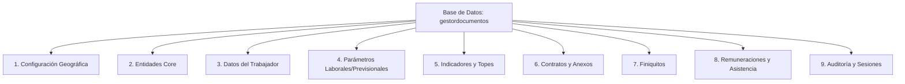
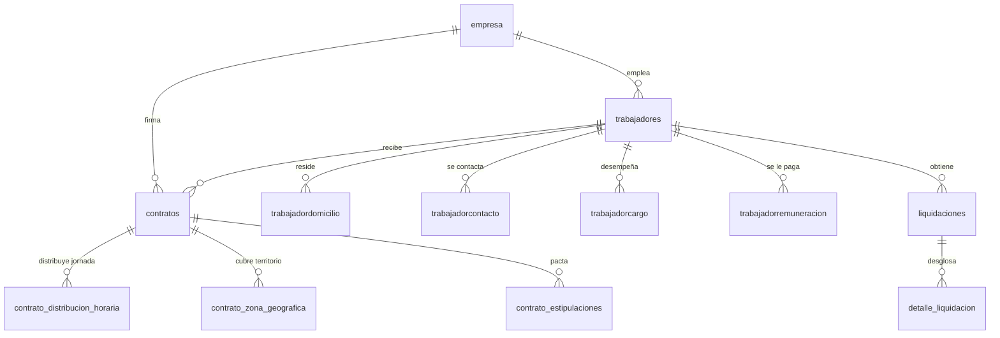

# Documentación de la Base de Datos (`gestordocumentos`)

Esta sección documenta el diseño, la organización y la estructura de la base de datos de **GD2.0 (Gestor de Documentos)**. La base de datos está implementada sobre **MySQL/MariaDB** y consta de tablas maestras, tablas operativas y tablas relacionales de soporte.

---

## 1. Clasificación Lógica de las Tablas

Para facilitar su comprensión, las tablas se agrupan en las siguientes categorías funcionales:

---

## 2. Detalle de Categorías y Tablas Clave

### A. Entidades Core (Principales del Negocio)

Estas tablas representan a los actores y organizaciones principales del sistema.

| Tabla | Propósito | Campos Clave | Relaciones Principales |
|---|---|---|---|
| `users` | Usuarios que acceden al sistema administrativo con distintos roles. | `id_usu` (PK), `email`, `password`, `tipousuario` | Relaciona con `tipousuario` y `usuarioempresa`. |
| `empresa` | Empleadores registrados en la plataforma. | `id` (PK), `rut`, `razonsocial`, `cajascompensacion`, `mutuales` | Relaciona con `cajascompensacion` y `mutuales`. |
| `representantelegal` | Representantes autorizados para firmar y celebrar contratos. | `id` (PK), `rut`, `nombre`, `empresa` | FK a `empresa(id)`. |
| `centrocosto` | Subdivisiones organizacionales de las empresas para clasificar gastos. | `id` (PK), `codigo`, `nombre`, `empresa` | FK a `empresa(id)`. |
| `subcentrocosto` | Apertura de segundo nivel de los centros de costo. | `id` (PK), `nombre`, `centrocosto` | FK a `centrocosto(id)`. |

### B. Datos y Ficha del Trabajador

Almacenan la información personal, previsional, de contacto e historial de cada empleado.

| Tabla | Propósito | Campos Clave | Relaciones Principales |
|---|---|---|---|
| `trabajadores` | Tabla central del empleado (datos básicos como nombre y RUT). | `id` (PK), `rut`, `nombre`, `sexo`, `estadocivil`, `nacionalidad`, `empresa` | FK a `empresa(id)`, `sexo(id)`, `estadocivil(id)`. |
| `trabajadordomicilio` | Dirección y ubicación física del trabajador. | `id` (PK), `trabajador`, `region`, `comuna`, `calle`, `numero` | FK a `trabajadores(id)`, `regiones(id)`, `comunas(id)`. |
| `trabajadorcontacto` | Teléfono y correo electrónico de contacto del trabajador. | `id` (PK), `trabajador`, `telefono`, `email` | FK a `trabajadores(id)`. |
| `trabajadorcargo` | Puesto, cargo o función desempeñada y departamento. | `id` (PK), `trabajador`, `cargo` | FK a `trabajadores(id)`, `cargos(id)`. |
| `trabajadorremuneracion` | Configuración del sueldo base y tipo de sueldo asignado. | `id` (PK), `trabajador`, `sueldobase`, `tiposueldo` | FK a `trabajadores(id)`. |
| `cargastrabajador` | Cargas familiares y asignaciones familiares asociadas. | `id` (PK), `trabajador`, `rut`, `nombre`, `parentesco` | FK a `trabajadores(id)`. |
| `vacaciones` | Registro de días de vacaciones tomados, acumulados y pendientes. | `id` (PK), `trabajador`, `dias`, `fechainicio`, `fechatermino` | FK a `trabajadores(id)`. |
| `licenciamedica` | Licencias médicas ingresadas al sistema para justificar inasistencias. | `id` (PK), `trabajador`, `fechainicio`, `fechatermino`, `documento` | FK a `trabajadores(id)`. |

### C. Módulo de Contratos (V2.0)

Estructura diseñada para almacenar las variables requeridas en los contratos individuales y masivos, cumpliendo con las normativas de la Dirección del Trabajo (DT).

*   **`contratos`**: Tabla principal de contratos.
    *   *Campos clave*: `id` (PK), `trabajador` (FK), `empresa` (FK), `cargo` (varchar/id), `sueldo` (decimal), `fechainicio` (date), `fechatermino` (date), `formato_contrato` (int), `categoria_contrato` (varchar), `fecha_suscripcion` (date).
*   **`contrato_distribucion_horaria`**: Horarios específicos de entrada y salida ordenados por turno y día.
    *   *Campos*: `id` (PK), `contrato_id` (FK a `contratos(id)`), `tipo_turno` (normal, matutino, tarde, noche), `dia_semana` (1-7), `dia_seleccionado` (0-1), `hora_inicio` (time), `hora_termino` (time).
*   **`contrato_zona_geografica`**: Comunas y regiones habilitadas para el traslado del trabajador.
    *   *Campos*: `id` (PK), `contrato_id` (FK a `contratos(id)`), `tipo_zona` (region, provincia, comuna), `zona_id` (int).
*   **`contrato_estipulaciones`**: Cláusulas o estipulaciones personalizadas adicionales (hasta 13 estipulaciones por contrato).
    *   *Campos*: `id` (PK), `contrato_id` (FK a `contratos(id)`), `numero_estipulacion` (1-13), `contenido` (text).

### D. Parámetros Laborales y Previsionales (Tablas Maestras Chilenas)

*   `afp` / `tasaafp`: Administradoras de Fondos de Pensiones de Chile (Habitat, Provida, Capital, Cuprum, Modelo, PlanVital, Uno) y sus tasas mensuales de cotización obligatoria.
*   `isapre`: Instituciones de Salud Previsional (Fonasa, Banmédica, Colmena, Consalud, CruzBlanca, Nueva Masvida, Vida Tres).
*   `cajascompensacion` / `mutuales`: Cajas de Compensación (Los Andes, La Araucana, 18 de Septiembre) y Mutuales de Seguridad (ACHS, Mutual de Seguridad CChC, IST) con sus respectivas tasas de cotización básica y adicional.
*   `segurosocial_sis`: Tasas del Seguro de Invalidez y Sobrevivencia.
*   `segurosocial_expectativadevida` / `segurosocial_rentabilidadprotegida`: Tasas predeterminadas complementarias de seguridad social.

### E. Indicadores Económicos y Topes Legales

Estas tablas se actualizan periódicamente según los valores oficiales entregados por el gobierno de Chile (Previred / SII):

*   `uf` (Unidad de Fomento): Utilizada principalmente para cotizaciones de salud pactadas en UF.
*   `utm` / `uta` (Unidad Tributaria Mensual / Anual): Utilizadas para el cálculo del Impuesto de Segunda Categoría.
*   `sueldominimo`: Sueldo mínimo mensual de los trabajadores.
*   `tramosasignacionfamiliar`: Valores y tramos de ingresos para el pago de la carga familiar (Tramos A, B, C, D).
*   `topeafp` / `topeips` / `topecesantia` / `topeapvmensual` / `topeapvanual`: Límites máximos imponibles para pensiones, salud y cesantía.

### F. Remuneraciones y Asistencia

Tablas vinculadas al procesamiento mensual de la nómina / liquidación de sueldos.

*   `asistencia`: Días trabajados, inasistencias y horas extras ingresadas para cada período de remuneración.
*   `liquidaciones`: Histórico mensual de liquidaciones emitidas.
    *   *Campos clave*: `id` (PK), `trabajador` (FK), `empresa` (FK), `periodo` (ej: 202607), `sueldoliquido`, `totalimponible`, `totalhaberes`, `totaldescuentos`.
*   `detalle_liquidacion`: Desglose ítem por ítem (haberes y descuentos) calculado para cada liquidación de sueldos.
*   `haberes_descuentos_trabajador`: Bonos, haberes (gratificaciones, colación, movilización) y descuentos (anticipos, préstamos) fijos o variables asignados a cada empleado.

---

## 3. Relaciones Principales del Modelo (Diagrama ER Simplificado)

El siguiente diagrama muestra cómo interactúan las tablas principales alrededor de la entidad **trabajador**:

---

## 4. Mantenimiento y Buenas Prácticas

1.  **Integridad Referencial**: Gran parte de los nuevos campos agregados (tales como `cargo_id`, `afp_id`, `salud_id`, `banco_id`, etc.) se definen como `NULL` para garantizar la compatibilidad con contratos antiguos generados en versiones previas del software. Sin embargo, en nuevas inserciones, la capa backend ([php/pdf/confirmarcontrato.php](file:///c:/xampp/htdocs/GD2.0/php/pdf/confirmarcontrato.php)) valida la obligatoriedad de la mayoría de estos datos según la ley.
2.  **Fechas e Indicadores**: Los campos de fechas utilizan el formato estándar `YYYY-MM-DD` de MySQL para facilitar cálculos y ordenamiento nativos.
3.  **Montos y Sueldos**: Los valores monetarios y cotizaciones se definen bajo tipos `decimal(10,2)` o `decimal(12,2)` para evitar errores de redondeo de punto flotante en el cálculo de impuestos y sueldo líquido.
