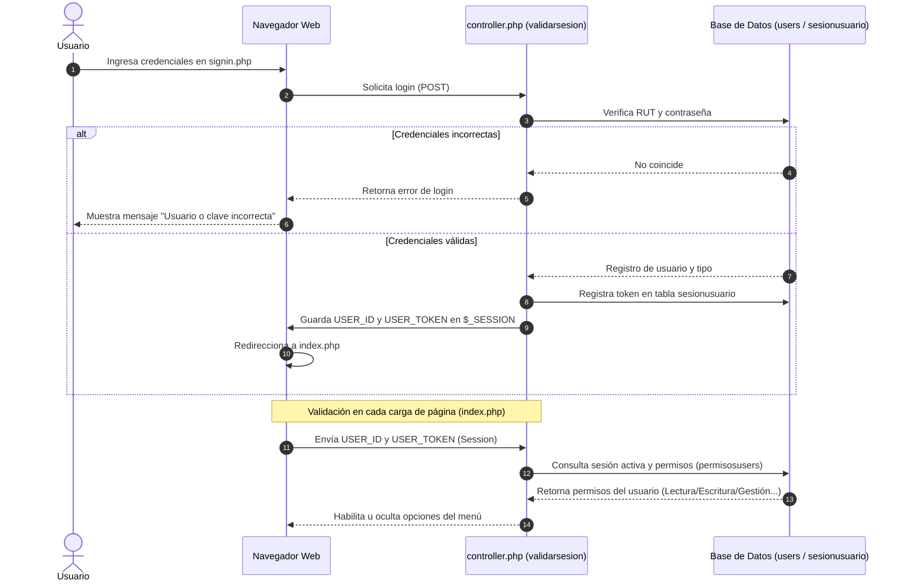
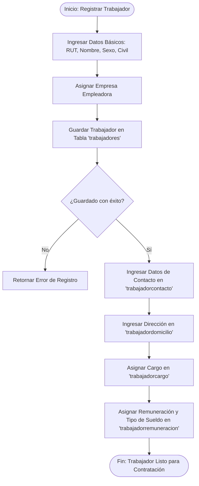
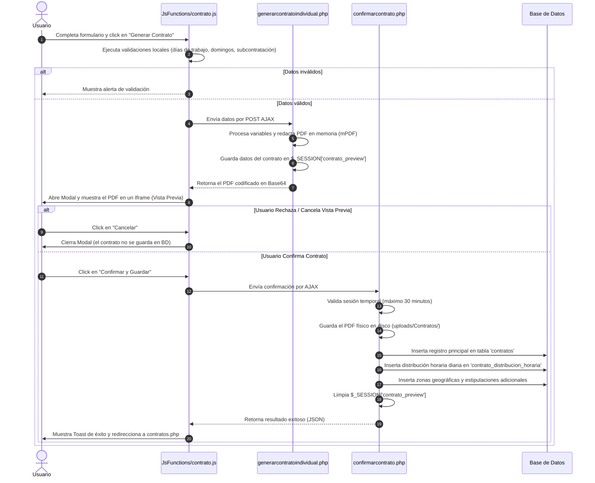
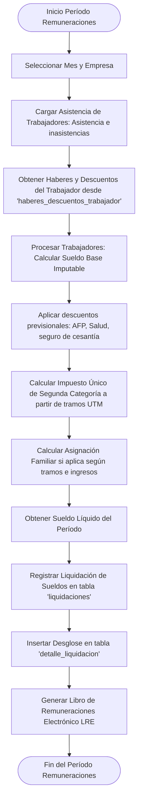

# Documentación de Flujos y Procesos del Sistema

Este documento describe detalladamente los flujos de trabajo críticos de **GD2.0 (Gestor de Documentos)**, ilustrados mediante diagramas de secuencia y diagramas de flujo.

---

## 1. Flujo de Autenticación y Control de Acceso

Este proceso asegura que los usuarios que ingresan al sistema cuenten con una sesión activa y válida, y carga los permisos específicos del rol del usuario para restringir las funciones del menú lateral.

---

## 2. Proceso de Registro de un Trabajador (Ficha de Empleado)

La creación de un trabajador en la base de datos es un proceso estructurado para garantizar que los datos personales, previsionales y contractuales sean consistentes.

---

## 3. Flujo de Creación y Aprobación de Contrato (V2.0)

Este proceso implementa una separación clara entre la generación visual del documento PDF y la escritura definitiva en la base de datos (evitando registros inconsistentes o basura en el disco).

---

## 4. Proceso de Cálculo de Remuneraciones Mensual

Este proceso consolida los haberes fijos del trabajador, la asistencia mensual (días laborados, faltas, licencias) y calcula los montos a pagar del período.

